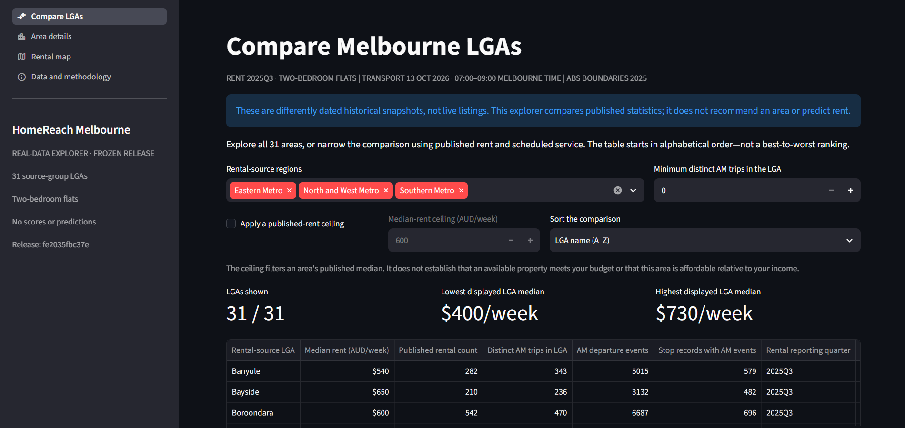
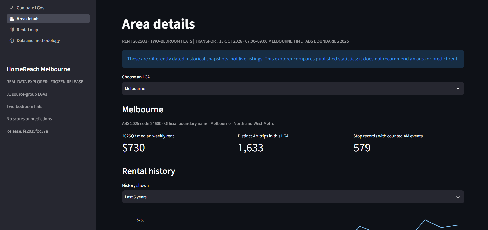
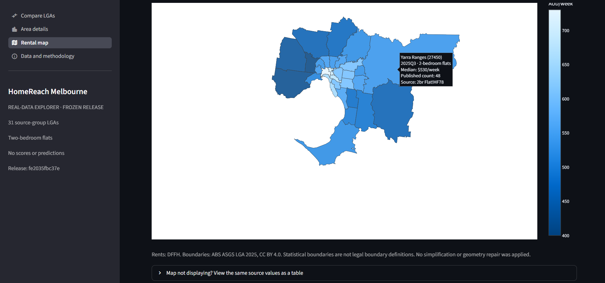
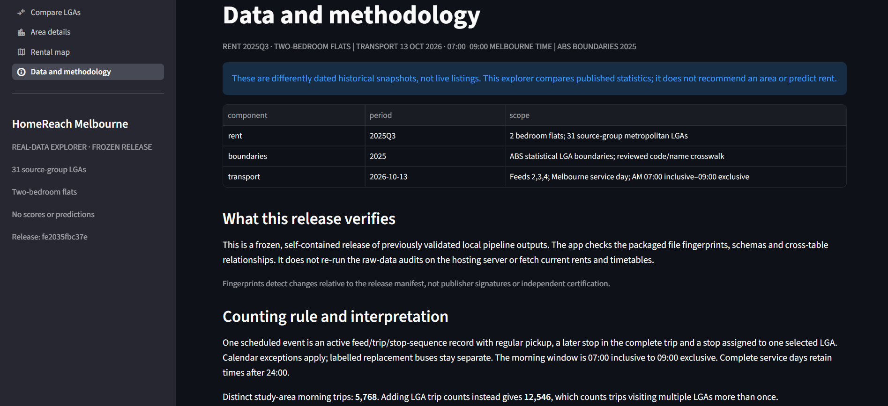
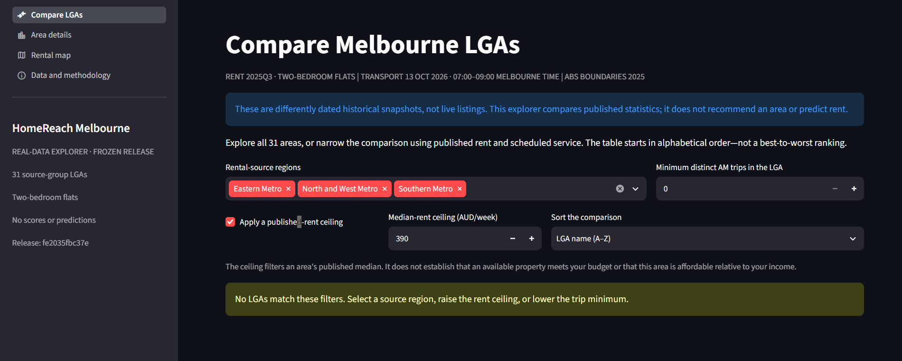

# HomeReach Melbourne

**Explore published rental costs and scheduled public transport across 31 Melbourne LGAs.**

[Open the deployed explorer](https://homereach-melbourne-kbytxx6wtdxw3sxas656gh.streamlit.app/) · [First deployed release](docs/releases/first-deployed-explorer.md) · [Data sources and attribution](deploy/DATA_SOURCES.md)

HomeReach Melbourne is a data-science project that turns official rental statistics,
transport timetables and geographic boundaries into a reproducible, interactive
comparison. It combines source audits, data cleaning, reviewed geographic joins,
service-indicator engineering, automated tests and a hosted Streamlit application.

The `feat/rental-forecast-baselines` branch also records completed retrospective
rental-forecast experiments and a tested reusable implementation. See the
[research summary](docs/rental_modelling_summary.md) and
[model card](docs/model_card.md) for their methods, results and limitations.

> **The deployed application is a descriptive explorer of differently dated snapshots.** Rent is from
> **2025Q3**; scheduled transport is for **13 October 2026**; LGA boundaries are
> **ABS 2025**. It is not a live property search, a recommendation ranking, a
> commute-time calculator or a forecasting service.



## Why this project?

Comparing areas requires more than ordering a list of rents. Published rental
statistics and transport schedules describe different things, use different
identifiers and cover different periods. HomeReach makes those differences
explicit while giving users a way to inspect the data together.

The explorer's question is: **How do published rents and scheduled morning service
supply vary across the selected LGAs?** It does not assume that a cheap area, or
an area with many stop visits, is automatically a suitable place to live.

The forecasting research asks: **How accurately can next quarter's published
median weekly rent for two-bedroom flats be predicted from earlier observations
of the same LGA?** It evaluates historical forecasts separately from the deployed
explorer's descriptive comparisons.

## Explore the application

| Page | Implemented functionality |
|---|---|
| **Compare LGAs** | Filter by rental-source region, an optional published-median-rent ceiling and a minimum distinct morning-trip count; sort the table, inspect a scatter plot and download the comparison. |
| **Area details** | Select an LGA; inspect quarterly rental history, morning/full-service-day category breakdowns, stop-record denominators and original Excel source-cell references. |
| **Rental map** | Explore 31 LGA polygons coloured by published median weekly rent. Hover displays the area, reporting period, rental count and source cell. Online background tiles are optional. |
| **Data and methodology** | Read the source periods, event-counting rules, limitations, publisher attribution and frozen-release manifest. |

The default comparison is alphabetical, not a best-to-worst ranking. A rent
ceiling filters an area's published median; it does not establish that an
available property meets that budget.

<details>
<summary>View area details, the rental map, methodology and empty-result handling</summary>

### Area details



### Rental map



### Methodology



### Empty filter result



These are cropped screenshots of the deployed application supplied by the project
maintainer. They illustrate the displayed state; they are not a record of every
possible interaction or proof of anonymous access.

</details>

## Snapshot and analytical scope

| Component | Period and coverage | Source / evidence |
|---|---|---|
| Rental history | **1999Q2–2025Q3**, 106 quarters, 31 selected LGAs, **2 bedroom flats**; 3,286 LGA-quarter rows | [DFFH rental report](https://www.dffh.vic.gov.au/publications/rental-report); [rental pipeline](docs/rental_pipeline.md) |
| Rental comparison | **2025Q3**; one published median and count per selected LGA | [Combined analysis](docs/transport_rent_eda.md) |
| Boundaries | **ABS LGA 2025**, GDA2020; transformed to WGS84 for the web map | [Source attribution](deploy/DATA_SOURCES.md); [geography pipeline](docs/geography_pipeline.md) |
| Transport | **2026-10-13**, Australia/Melbourne service-day time; operational feeds **2, 3 and 4** | [Transport Victoria GTFS Schedule](https://opendata.transport.vic.gov.au/dataset/gtfs-schedule); [transport pipeline](docs/transport_pipeline.md) |
| Morning window | **07:00 inclusive to 09:00 exclusive** | [Service-indicator method](docs/gtfs_service_indicators.md) |

The study area is the rental source's **North and West Metro, Eastern Metro and
Southern Metro** groups. An LGA is a local government area, not an individual
suburb. This scope is not silently replaced by a different definition of Greater
Melbourne.

## From sources to the deployed explorer

```text
DFFH rental workbook       ABS boundaries       Transport Victoria GTFS
        |                        |                         |
   Audit and clean         Review identifiers       Audit feeds/calendars
        |                        |                         |
        +------ LGA crosswalk ---+---- Stop-to-LGA spatial join
                         |                    |
                  Rental statistics   Scheduled-service indicators
                         |                    |
                         +--- Verified comparison ---+
                                                     |
                                    Application-ready local bundle
                                                     |
                                    Allowlisted portable data release
                                                     |
                                     Hosted Streamlit explorer
```

**Rental preparation:** Count and Median columns are kept separate; aggregate rows
are excluded; source filenames, worksheet names and Excel cell references are
retained. The analytical key is `(rental_area_name, quarter, property_type)`.

**Geographic matching:** 28 rental names match exactly. Three reviewed aliases
resolve Bayside, Kingston and the source abbreviation `Mornington Penin'a`.
Stop/platform points are assigned only to one unique strict-interior LGA polygon.
Outside and ambiguous cases are retained, not snapped to the nearest area.

**Transport processing:** Feed-specific identifiers remain distinct. Calendar
exceptions override weekly schedules. Labelled replacement buses stay separate.
A counted departure event requires an active trip, regular pickup, a later stop
in the complete trip and an assigned LGA. Terminal detection happens before
geographic or time filtering. GTFS times at or beyond `24:00:00` are retained for
the complete service day, not wrapped modulo 24.

**Release packaging:** Only eight CSV tables, one GeoJSON, source attribution and
a release manifest are published under `deploy/data`. The serving app reads that
frozen subset, not the raw archives or the developer's upstream reports. Packaged
fingerprints detect changes relative to the manifest; they are not publisher
signatures or independent certification.

## Verification at the first deployed release

The deployed code snapshot is [`35b84e7`](https://github.com/HeomapTV123/homereach-melbourne/commit/35b84e700f373e5d9c8538bbf696c1dbf7d07d65).
Its data-release identifier begins **`fe2035fbc37e64a4`**; the full identifier is in
[the release manifest](deploy/data/release_manifest.json).

| Check | Recorded result |
|---|---|
| Automated test suite | **352 passed** locally and in [GitHub Actions run #16](https://github.com/HeomapTV123/homereach-melbourne/actions/runs/41113511058) |
| Rental-to-boundary join | **31/31 matched**, with no duplicate LGA codes |
| Selected stop/platform records | **25,031**: 21,426 assigned, 3,605 outside the selected polygons retained |
| Stop-time records scanned in the scoped GTFS audit | **11,847,183** |
| Counted morning events inside the study area | **158,932** |
| Distinct morning trips across the study area | **5,768**, not the sum of LGA-specific trip counts |
| Service summary grid | **248 rows**: 31 LGAs × 4 service categories × 2 windows |
| Portable release | **11 files**, loadable without raw datasets or local pipeline reports |

These checks verify the implemented transformations and the selected snapshot;
they do not establish complete GTFS certification, real-world operational accuracy
or the suitability of an area. The release CI passed with pandas deprecation
warnings; dependency compatibility remains a maintenance task. The test count is
a record for this code snapshot, not a permanently fixed target.

## Completed rental-forecast research

The first modelling round is recorded on `feat/rental-forecast-baselines`.
It uses the same 31 rental-source LGAs and two-bedroom-flat series, with nominal
AUD/week as the target unit. Initial history is **1999Q2–2018Q4**, development
validation is **2019Q1–2023Q3** (589 targets per method), and the fixed final
evaluation is **2023Q4–2025Q3** (248 targets per method).

Every forecast targets the next quarter using that LGA's history through the
previous quarter. Both Ridge methods refit a training-only StandardScaler and
Ridge model at every origin, with alpha **1.0**, an intercept and the SVD solver.
The candidate predicts quarterly change and adds a fixed **0.5** of that predicted
change to the last observed rent. Earlier final-period outcomes enter history
only for later origins under the fixed rolling procedure.

### Findings

| Method | Role in final evaluation | Validation MAE | Final MAE |
|---|---|---:|---:|
| Last observation | Primary reference | 10.9728 | 13.6089 |
| Half-adjusted change Ridge | Primary candidate | 10.9133 | 13.1493 |
| Earlier level Ridge | Secondary reference | 13.2135 | 13.7226 |
| Seasonal naive | Secondary reference | 25.2937 | 40.6411 |

MAE is measured in nominal AUD/week, with equal weight for each LGA-quarter.
The primary candidate reduced final MAE by approximately **0.4595 AUD/week
(3.3767%)** relative to last observation. Its MAE was lower in **21 LGAs** and
higher in **10**. Full RMSE, signed-error and paired-comparison results are in
the [final evaluation report](docs/rental_final_evaluation.md) and
[model card](docs/model_card.md).

This is a modest, mixed later-period result. The candidate was developed after
validation diagnostics; final outcomes had appeared in earlier descriptive work.
One workbook vintage was used, without reconstructing historical publication
lags or revisions. The study is a retrospective evaluation, and its descriptive
error differences do not establish statistical significance or future performance.
The completed final period is not a new tuning set. Forecasting remains research
work; the hosted application serves the descriptive release above.

### Research trail

| Notebook | Purpose |
|---|---|
| [09 — Forecast baselines](notebooks/09_rental_forecast_baselines.ipynb) | Last-observation and seasonal-naive validation benchmarks |
| [10 — Level Ridge](notebooks/10_rental_ridge_validation.ipynb) | Fixed per-LGA level regression and baseline comparison |
| [11 — Error diagnostics](notebooks/11_rental_ridge_error_diagnostics.ipynb) | Inspect the saved validation errors |
| [12 — Change correction](notebooks/12_rental_correction_validation.ipynb) | Evaluate the fixed half-adjusted change candidate |
| [13 — Final evaluation](notebooks/13_rental_final_evaluation.ipynb) | Evaluate the four methods under the committed final protocol |

The [modelling summary](docs/rental_modelling_summary.md) connects these stages.
The [refactor guide](docs/forecasting_refactor.md) documents the reusable package
and its regression/equivalence checks.

### Research verification checkpoint — 11 November 2026

The maintainer verified the refactor locally before committing it as
[`cc46371`](https://github.com/HeomapTV123/homereach-melbourne/commit/cc46371fe16310ce24150cb85a07b27dac3df656).

| Check | Recorded local result |
|---|---|
| Complete automated test suite | **490 passed** in **105.05 seconds**, in the Windows `homereach` environment |
| Saved notebook 13 evidence | **13/13 CSV tables matched** |
| Fixed calculation reproduced | **992 forecasts**, **496 trained fits** |
| Read-only equivalence run | **0 project files written**; **0 additional independent final tests** |

The 490 cases comprise the earlier 352 tests plus 138 forecasting/equivalence
cases. The comparison ran while Git HEAD was `dce9b7b`; `cc46371` then recorded
the tested files. The original final-evaluation execution remains `2919a4e`,
with the protocol locked at `d0858bd`.

This is a local verification record. The [CI workflow](.github/workflows/ci.yml)
at `cc46371` triggers on pushes to `main` and pull requests targeting `main`;
the direct research-branch push did not trigger a GitHub Actions run. The
352-test entry above remains the historical first-deployed-release checkpoint.

### Compatibility maintenance checkpoint — 11 November 2026

The later pandas compatibility patch was committed and pushed as
[`2cebd1b`](https://github.com/HeomapTV123/homereach-melbourne/commit/2cebd1b).
Its three added regression cases bring the complete suite to **493 tests**.

| Check | Recorded result |
|---|---|
| Local complete test suite | **493 passed in 54.81 seconds**, in the Windows `homereach` environment |
| GitHub Actions test suite | **493 passed in 25.42 seconds** in [run #19](https://github.com/HeomapTV123/homereach-melbourne/actions/runs/43056263652) |
| Standalone release verification | **11 files verified**; release identifier still begins `fe2035fbc37e64a4` |

Both recorded pytest runs completed without pandas warnings. The packaged data
release remains unchanged. The **352-test** first-release record and **490-test**
refactor record above retain their original scope and dates. The completed
**13/13 saved-table comparison** belongs to the earlier refactor checkpoint;
this compatibility-maintenance record is not another forecast evaluation.

## Run the packaged application locally

**No raw-data download or full pipeline rebuild is required for this path.**
Use Python **3.12** and the committed `deploy/data` directory. The commands below
are for a new checkout; an existing checkout can skip cloning.

### Windows (PowerShell or Command Prompt)

```powershell
git clone https://github.com/HeomapTV123/homereach-melbourne.git
cd homereach-melbourne
py -3.12 -m venv .venv
.\.venv\Scripts\python.exe -m pip install -r deploy/requirements.txt
.\.venv\Scripts\python.exe scripts/verify_explorer_release.py
.\.venv\Scripts\python.exe -m streamlit run deploy/streamlit_app.py --server.port 8503
```

The direct virtual-environment Python path avoids needing a PowerShell activation
script. Open the Local URL printed by Streamlit.

### macOS / Linux

```bash
git clone https://github.com/HeomapTV123/homereach-melbourne.git
cd homereach-melbourne
python3.12 -m venv .venv
.venv/bin/python -m pip install -r deploy/requirements.txt
.venv/bin/python scripts/verify_explorer_release.py
.venv/bin/python -m streamlit run deploy/streamlit_app.py --server.port 8503
```

The standalone verifier should report **31 comparison LGAs**, **3,286 rental
history rows** and **11 verified release files**, with no local pipeline reports
or raw datasets read. Keep `deploy/.gitattributes`: its data-file rule preserves
byte-specific fingerprints across operating systems. Investigate integrity
errors; do not edit hashes to suppress them.

### Three separate application entry points

| Entry point | Purpose | Requirements |
|---|---|---|
| `deploy/streamlit_app.py` | Portable frozen release; the hosted application | Serving dependencies and committed `deploy/data` |
| `app/Explore.py` | Local real-data explorer | Completed local explorer bundle and upstream build reports |
| `app/Home.py` | Original synthetic demonstration | Fictional sample inputs; not the real-data release |

## Develop or reproduce the pipelines

Use the full development environment for GIS processing, notebook work and the
complete test suite. Do not recreate an already-working `homereach` environment.

```bash
# From the repository root; create the environment only on a new setup.
conda env create -f environment.yml
conda activate homereach
python -m pytest -o "addopts=" -q
```

The development environment installs the local package in editable mode. A fresh
checkout can run the synthetic tests without the official raw archives. Full
source reconstruction requires the **exact audited snapshots**, not whatever
newer files a publisher currently distributes.

Retain the original filenames and put them at:

```text
data/raw/rent/quarterly-median-rents-local-government-area-september-quarter-2025-excel.xlsx
data/raw/geography/LGA_2025_AUST_GDA2020.zip
data/raw/transport/gtfs.zip
```

Follow the source-audit notes and configuration before running these jobs in order:

```bash
python scripts/build_rent_panel.py --update-registry
python scripts/build_lga_geography.py --update-registry
python scripts/build_transport.py --update-registry
python scripts/build_explorer_data.py
```

The notebooks document how the methods were established; the reusable jobs
perform the builds. Existing notebook exports are compared when available, with
missing references reported rather than invented. Configuration pins source
fingerprints and scope; a different archive requires a new audit. Do not change
an expected fingerprint or delete previous exports merely to pass a check.

Packaging a **reviewed local bundle** is a separate step:

```bash
python scripts/package_explorer.py --check-only
python scripts/package_explorer.py
python scripts/verify_explorer_release.py
```

An identical packaged release is preserved. A changed existing release stops for
review; this is not a general automatic-update command. See the
[deployment guide](docs/explorer_deployment.md) before replacing published data.
The original sources, most intermediate/processed outputs and credentials must
not be force-added to Git. `deploy/data` is the deliberate publication exception.

### Verify the completed forecasting refactor

From the project root on `feat/rental-forecast-baselines`, with the existing
development environment installed:

```bat
conda activate homereach
git branch --show-current
python -m pytest -o "addopts=" -q
python scripts/verify_rental_forecast_refactor.py --check-only
```

The automated tests use fictional inputs and temporary files. The separate
equivalence command requires the original completed local research evidence:
`data/processed/rent_quarterly.csv`, its quality report, the preceding experiment
manifests/outputs and `data/interim/rental_final_evaluation/`. Those files are
Git-ignored, so a fresh clone can run the tests but cannot perform that saved-file
comparison until the original evidence is available.

The command validates the frozen protocol and evidence fingerprints, then compares
all 13 tables using the documented schemas, keys and numeric tolerances. It is
read-only and stops on missing or changed evidence. Reproducing the same scored
period verifies the implementation; it does not create another independent final
test. See the [refactor guide](docs/forecasting_refactor.md) for the full contract.

## Repository guide

| Location | Role |
|---|---|
| `notebooks/01`–`08` | Source audits, rental EDA, maps, GTFS analysis and combined EDA |
| `notebooks/09`–`13` | Rental baselines, level Ridge, validation diagnostics, change correction and fixed final evaluation |
| `src/homereach/io`, `geography`, `transport` | Reusable source preparation and geographic/service validation |
| `src/homereach/explorer` | Comparison logic, bundle validation, charts, local UI and release loading |
| `src/homereach/forecasting` | Fixed forecast construction, evaluation tables and saved-evidence comparison |
| `scripts/` | Reproducible builders, release verification, and frozen-protocol/forecast-refactor checks |
| `config/` | Audited snapshots, explicit name aliases and frozen research protocols |
| `deploy/` | Hosting entry point, serving dependencies, attribution and packaged data |
| `tests/` | Unit/integration checks, forecast regression/equivalence cases and Streamlit AppTest interactions |
| `docs/` | Methods, source registry, model card, research findings, implementation guides and release evidence |

Start with the [real-data explorer guide](docs/real_data_explorer.md),
[deployment guide](docs/explorer_deployment.md),
[combined EDA findings](docs/transport_rent_eda.md) and
[data registry](docs/data_registry.csv). For forecasting, start with the
[modelling summary](docs/rental_modelling_summary.md) and [model card](docs/model_card.md).

## Interpretation boundaries

Rent values are historical nominal area medians, not live listings, fixed-property
histories or household-income affordability estimates. LGA medians must not be
averaged to manufacture a metropolitan median.

Transport indicators measure scheduled stop-record visits and distinct contributing
trip IDs for one date. They are not riders, vehicles, capacity, actual punctuality,
regular headways, waiting times or destination-specific commute times. Trips can
serve several LGAs; adding LGA distinct-trip counts double-counts them.

The selected feeds do not include every transport operation. LGA size, stop
placement and repeated/co-located source records affect counts. A stop outside a
polygon may serve residents inside it; point-in-polygon membership is not a
walking catchment. Unknown accessibility fields are not treated as inaccessible.
ABS statistical boundaries are not legal boundary definitions.

The newer transport snapshot is not backfilled into historical rental-model
validation. The release does not fetch newer rents or timetables automatically,
and contains **no combined suitability score, forecast or recommendation**.

## Further work

The first chronological rental-forecasting round is complete on the research
branch. Any later model redesign needs disclosed development and additional
independent evaluation evidence; the already-scored final period cannot provide
a fresh test of choices made after inspecting its errors.

Potential further work includes destination-based routing, better-justified access
measures and a reviewed snapshot-refresh process. Each needs its own data,
validation and interpretation work before a deployment proposal. Dependency
maintenance and usability improvements remain separate engineering work.

The [scheduled commute pilot](docs/commute_routing_pilot.md) now starts with a
read-only input preflight: `python scripts/check_routing_inputs.py`. It checks the
original local GTFS archive against the audited snapshot and reports missing
routing prerequisites. Street-network data and verified origin/destination
coordinates are not yet configured; no journey times have been produced.

## Sources, attribution and project ownership

Source publishers are **Homes Victoria / DFFH**, **Transport Victoria / Department
of Transport and Planning**, and the **Australian Bureau of Statistics**. Dataset
attribution, source links, licence evidence and transformations are documented in
[deploy/DATA_SOURCES.md](deploy/DATA_SOURCES.md) and the public
[source-attribution record](deploy/data/source_attribution.json).

The source-data licence statements are not a licence for HomeReach's application
code. This documentation update does not add or change a source-code licence.
This is an independent student project; no publisher endorsement is implied.

Maintained by [HeomapTV123](https://github.com/HeomapTV123). Project issues and
reproducible bug reports can be recorded in the repository's Issues tab. Do not
post credentials, personal records or raw private data in an issue.
