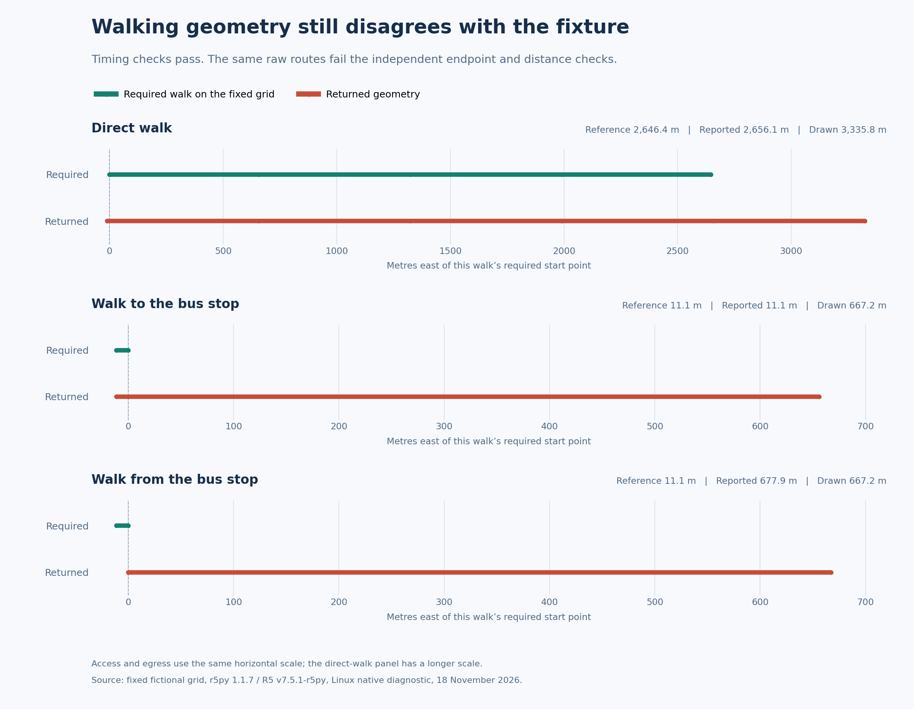

# Walking geometry and reverse-search cost investigation

## Checkpoint

This document preserves the geometry-baseline investigation at `1be659f`. The maintainer's [subsequent Windows output](evidence/routing_geometry_windows_checkpoint_2026-11-18.json) confirms the Linux failure counts below, with zero timing failures and exit code 1. A separate [experimental walking correction](commute_routing_walking_correction.md) now passes the unchanged fixture's timing, geometry, distance and duration checks on Linux. That new mode remains unverified on Windows and is restricted to the reviewed synthetic fixture; the original failed reports and reference oracle are preserved.

The maintainer's Windows run at `73543a8` passed the synthetic timing/integration checks with `--isolate-itinerary-legs`: 60 alternatives, no chronology, wait, sequence or egress-padding failures, 180 leg snapshots, restoration of the original method and exit code 0. The [Windows checkpoint](evidence/routing_smoke_windows_checkpoint_2026-11-18.json) records the supplied console evidence; it does not claim an independently captured Windows raw-leg report.

The optional `--check-walking-geometry` check tests additional requirements. **Its baseline fails on Linux and Windows while all previous timing checks continue to pass.** The engine returns walking lines that do not meet the requested endpoints, and the final walk has an excessive distance and duration. These are separate defects from the cached-leg timestamp problem addressed by the existing adapter.

The [expanded native report](evidence/routing_walk_geometry_linux_2026-11-18.json) retains every raw leg, its GeoJSON geometry and CRS. All preexisting row fields, engine identity and fixture fingerprints match the earlier isolated passing report. The experiment uses the same fictional grid, timetable, coordinates and routing parameters. No Melbourne journey was computed.

## Independent reference and observations

[`scripts/routing_walk_geometry.py`](../scripts/routing_walk_geometry.py) reads the committed [OSM XML](../tests/fixtures/routing_smoke/streets.osm), checks that it matches the fixture generator, and proves that the required direct paths are covered by continuous, bidirectional residential ways with explicit walking access. It reads the stop coordinates from the deterministic GTFS tables. This reference does not derive an expected distance from the engine's returned route.

All three reference paths follow the grid row at latitude `0.018`. The origin is `(0.0061, 0.018)`, the first stop is `(0.0060, 0.018)`, the final stop is `(0.0300, 0.018)` and the destination is `(0.0299, 0.018)`. The transit access and egress walks should therefore both be short westward segments. The unobstructed direct walk follows the same row between the origin and destination.

| Walking leg | Reference distance | Reported distance | Length of returned geometry |
| --- | ---: | ---: | ---: |
| Direct walk | 2,646.439 m | 2,656.089 m | 3,335.848 m |
| Origin to first bus stop | 11.119 m | 11.100 m | 667.170 m |
| Final bus stop to destination | 11.119 m | 677.897 m | 667.170 m |

These measurements come from the expanded report. The returned egress line goes from longitude `0.030` east to `0.036`; the requested destination lies just west at `0.0299`. The direct and access geometries also include entire edges beyond the required endpoints.



The checker uses longitude/latitude in explicit `EPSG:4326`, a spherical radius of 6,371,000 metres, a two-metre endpoint/path allowance, and a length allowance of `max(2 metres, 0.002 × reference distance)`. Either LineString orientation is accepted and recorded, so reversing an otherwise correct coordinate sequence is not itself a failure. It checks endpoint locations, deviation from the reference path, geometry length against reported distance, and reported distance against the independently established path. It also rejects missing or malformed geometry, unsupported CRS and incomplete leg sequences.

Those tolerances are explicit fixture requirements; they are not a general claim about real-world routing precision. The direct walk's approximately 9.650-metre distance discrepancy exceeds its 5.293-metre allowance. At this diagnostic checkpoint its cost discrepancy had not been traced as completely as the final walk's reverse-search defect. The subsequent [index investigation](commute_routing_walking_correction.md#1-rebuild-the-fixed-fixtures-derived-street-index) identifies the containing edge's omission from the derived spatial index as a separate cause.

| Expanded diagnostic | Observed count |
| --- | ---: |
| Walking legs checked | 121 |
| Endpoint mismatches | 121 |
| Geometry length disagrees with reported distance | 121 |
| Reported distance disagrees with the direct reference | 61 |
| Geometry extends beyond the direct reference path | 121 |
| Malformed rows/geometries, incomplete options or unsupported CRS | 0 |
| Chronology, wait, sequence or egress-padding failures | 0 |

There is one direct walk and two walks for each of 60 transit alternatives. The 61 reported-distance failures comprise the direct walk and all 60 egress walks. Counts overlap because a leg can violate several requirements. The full report retains all 424 individual diagnostic messages; the console prints a short selection. No returned rows or coordinates are repaired or discarded.

## Confirmed native reverse-search defect

A separate [native state observation](evidence/routing_reverse_origin_state_linux_2026-11-18.json) compared two fresh R5 street searches from the same destination: one forward and one reverse. It used the same network and split point, inspected the initial states before traversal, and retained the original smoke-query results unchanged. These two additional diagnostic searches are recorded separately from the three fixture queries.

The selected split has a nearby vertex at `(0.030, 0.018)`, a far vertex at `(0.036, 0.018)`, an edge length of 666.797 metres and a perpendicular/endpoint offset of 11.099 metres. Before either search traverses the network:

| Initial state | Forward search distance | Reverse search distance |
| --- | ---: | ---: |
| Nearby vertex, index 26 | 11.099 m | 677.896 m |
| Far vertex, index 27 | 677.896 m | 11.099 m |

In the pinned [R5 `StreetRouter.setOrigin` source](https://github.com/r5py/r5/blob/v7.5.1-r5py/src/main/java/com/conveyal/r5/streets/StreetRouter.java), endpoint costs are calculated first. The reverse-search branch then swaps only the vertex fields. The nearby vertex receives the far vertex's cost. The incorrect cost is already present before any network traversal, establishing that this added edge length is not a necessary walking detour.

The zero-length connector to the bus stop adds R5's minimum one millimetre and one second, as implemented by [`EdgeStore`](https://github.com/r5py/r5/blob/v7.5.1-r5py/src/main/java/com/conveyal/r5/streets/EdgeStore.java). The forward stop state is 11.100 metres / 12 seconds; the reverse state is 677.897 metres / 678 seconds. The latter exactly matches the returned final walk. [`StreetPath`](https://github.com/r5py/r5/blob/v7.5.1-r5py/src/main/java/com/conveyal/r5/profile/StreetPath.java) obtains distance and duration from that terminal state.

This observation explains the excessive final-walk cost before Python itinerary assembly. The timing adapter copies cached leg objects; it does not correct the native starting cost. Changing only how `StreetPath` reverses its result would also leave this earlier error unresolved.

## Separate geometry construction issue

The pinned [r5py `StreetSegment` implementation](https://github.com/r5py/r5py/blob/v1.1.7/src/r5py/r5/street_segment.py) assembles geometry from complete street-edge geometries. It does not clip the first and last edge to these requested partial-edge endpoints. Distance and duration are copied separately from `StreetPath`, which is why a reported 11.100-metre access walk can have a 667.170-metre drawn line.

Correct native costs alone would not correct those lines. Conversely, clipping the displayed lines alone would conceal an incorrect native distance and duration. The new checker captures the raw geometry and tests both requirements independently.

## Version review and repair criteria

A read-only review on 18 November 2026 found `v1.1.7` as the latest published r5py release. Its [classpath source](https://github.com/r5py/r5py/blob/v1.1.7/src/r5py/util/classpath.py) pins the reviewed `v7.5.1-r5py` JAR. The same vertex-only reverse swap remains in the checked [R5 `v7.5.2-r5py` source](https://github.com/r5py/r5/blob/v7.5.2-r5py/src/main/java/com/conveyal/r5/streets/StreetRouter.java) and [R5 `v7.6-r5py` source](https://github.com/r5py/r5/blob/v7.6-r5py/src/main/java/com/conveyal/r5/streets/StreetRouter.java). The native-state evidence records those checks and release metadata. No newer runtime was installed or executed, and a version change has not been demonstrated to fix this case.

The repair criteria are to keep each vertex, directional back-edge, endpoint distance and time cost associated correctly, and to construct geometry from the selected partial edges. Regression coverage needs forward/reverse cases, both endpoint directions, partial-edge accounting and directional walking behavior. Geometry must begin and end at the actual requested locations and agree with the route's costs within the declared tolerances. The subsequent [bounded correction](commute_routing_walking_correction.md) meets the unchanged fixture's checks on Linux, adds an independent walking-duration assertion, and retains all returned rows.

This diagnostic checkpoint records the cause and does not replace the engine. The later correction is also not a production routing repair: its index guard permits only the reviewed fixture, its origin override applies only to the Python planner's router calls, and complete route enumeration remains unvalidated. Melbourne input compatibility, full GTFS stop-time references, public station access, transfers and accessibility require their own validation afterward.

## Verified Windows baseline reproduction

The supplied Windows timing and geometry-baseline results are complete. The following command reproduces the failing geometry baseline with the existing environment, local JAR and temporary directory in Anaconda Prompt / CMD:

```bat
cd /d "D:\My project\homereach_melbourne"
git switch feat/commute-location-review
git pull --ff-only origin feat/commute-location-review
conda run --no-capture-output --prefix "D:\homereach-conda\envs\homereach-routing" python -B scripts/run_routing_smoke_test.py --jar "D:\homereach-conda\r5-engine\r5-v7.5.1-r5py-all.jar" --work-root "D:\homereach-conda\tmp" --isolate-itinerary-legs --check-walking-geometry
echo Exit code: %ERRORLEVEL%
```

For this baseline, expect the expanded test to report **`FAILED` and exit code 1**, with zero timing/sequence failures and the geometry/distance problems shown above. Conda may append its generic failed-command message. This is an intentional detection of the unresolved engine behavior; it does not call for rebuilding the working environment. Omitting `--check-walking-geometry` retains the already verified timing-only mode.

To retain full evidence, add `--json` and redirect standard output to a new report outside the checkout. No changes to the engine, fixture or environment are needed to reproduce this diagnostic. For the next corrected Windows experiment, retain both flags and add `--correct-walking-paths` as documented in [the correction guide](commute_routing_walking_correction.md#next-windows-check).

## Verification of the diagnostic checkpoint

The local full regression suite passed **879 tests in 46.98 seconds**, with no skips. The new oracle tests run without Java or geospatial libraries and exercise correct reference results, the observed whole-edge geometries, malformed or incomplete rows, source/reference changes and output immutability. Runner tests check flag forwarding and rejection of missing or inconsistent geometry while preserving the previous timing checks.

The separate native Linux run completed in 10.085 seconds, returned all three fixture-query results, copied 180 cached legs, restored the original method and removed its temporary workspace. It used the same SHA-256-verified R5 JAR, a 1 GiB Java heap limit and one Python routing job. It exited with code 1, as expected, because the additional walking checks fail. The saved report records canonical-LF fingerprints of the code used at execution and an exact comparison of all preexisting returned fields against the earlier isolated report.

The native experiment reads no real project datasets and computes no Melbourne journeys. Ordinary CI exercises the validators and regression cases; it does not execute the native engine experiment.
