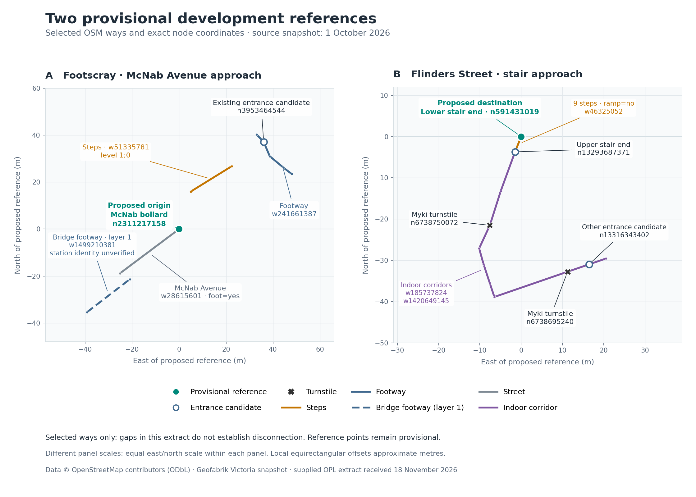

# Station access review: first Footscray-to-Flinders Street pilot

## Decision and scope

The [completed boundary diagnostic](commute_walk_boundary_review.md#completed-real-data-boundary-checkpoint) explains concrete exclusions at Footscray and Dandenong. The compact OSM extract supplied on 18 November 2026 now supports two **provisional station-area reference points** for the first development experiment. The selection is recorded in [routing_development_references.json](../config/routing_development_references.json).

| Role | Development reference | OSM node | Latitude | Longitude |
| --- | --- | --- | --- | --- |
| Origin | Footscray, McNab Avenue pedestrian approach | `2311217158` | -37.8019695 | 144.9018732 |
| Destination | Flinders Street, lower endpoint of mapped entrance stairs | `591431019` | -37.8177265 | 144.9671961 |

Coordinates use EPSG:4326. These points support a **stair-capable walking and scheduled-transit development experiment**. Their public access at the service time, engine linkage and routes to transit platforms remain unvalidated. They are not certified entrances, wheelchair-accessible routes or residential locations. The original entrance candidates remain in their existing configuration files; this manifest records a different purpose.

The other three origins remain available for later expansion. `config/routing_pilot.json` keeps its null street-network and location fields until the corresponding input checks are implemented. The provisional manifest is not currently loaded by that preflight. Selecting coordinates now enables the next development stage; checks that depend on an itinerary will be assessed on an explicitly labelled development run.

## Operator evidence reviewed on 18 November 2026

[Metro's official virtual-tour index](https://www.metrotrains.com.au/station-accessibility-features/virtual-station-tours/) links the two supporting documents below. Their filenames identify January 2021 updates and their URLs use a June 2021 upload directory. They describe station layout but do not by themselves establish operating conditions on 13 October 2026.

| Station | Official source | Relevant evidence and limitation |
| --- | --- | --- |
| Footscray | [Metro supporting document](https://ds12k1658w1f2.cloudfront.net/wp-content/uploads/2021/06/Footscray-Station-virtual-tour-DAT-TOC-update-January-21.docx.pdf), physical pages 4-6 | Describes the Irving/Hyde Street footbridge and access involving McNab Avenue. The McNab forecourt has level access to platforms 4 and 5 and links to the footbridge through vertical access features. It does not identify our OSM node or bridge way. |
| Flinders Street | [Metro supporting document](https://ds12k1658w1f2.cloudfront.net/wp-content/uploads/2021/06/Flinders-St.-Station-DAT-TOC-version-update-Jan-21.docx.pdf), physical pages 3-4 | Identifies the main entrance beneath the clocks at the southwest Flinders/Swanston corner as stair access and distinguishes level-access entrances on Swanston Street. This supports a specific entrance-identity comparison, not an approved OSM-coordinate match. |
| Flinders Street layout | [PTV precinct map](https://www.ptv.vic.gov.au/assets/DTP1124-FlindersStreetStation-Precinct-Map_Degraves-Subway_web_Stage-1_v3.pdf), one page | Shows named street/river exits and access features. It also labels Campbell Arcade closed for construction. Its effective date for the pilot has not been established, so that closure label is not adopted as an October 2026 fact. |

Both Metro documents explicitly warn that works can make their descriptions outdated. Their old opening hours and service details are not imported into the pilot.

## Evidence received and preserved

The [29-line OPL record](evidence/footscray_flinders_access_2026-11-18.opl.txt) contains 22 nodes and 7 ways. Every referenced node in the seven ways has coordinates in the record. It preserves the supplied object lines; terminal prompts were omitted. The receipt date is recorded because the transcript does not provide an execution timestamp.

Its UTF-8/LF SHA-256 is `f12daf766bad7e9d7ced70f2eb02c65f9e7bcaa58f75c782441e428f2a933a87`. Git may use CRLF in a Windows checkout; normalise line endings to LF before comparing this text-evidence hash. This is distinct from the hash of the original PBF.

The user successfully ran the following extraction from the original dated Victoria snapshot. It is recorded for provenance; it does not need to be repeated:

```bat
cd /d "D:\My project\homereach_melbourne"
conda activate homereach-osm
osmium getid -r "data\raw\routing\victoria-261001.osm.pbf" n3953464544 n13293687371 w241661387 w1499210381 w28615601 w51335781 w46325052 w185737824 w1420649145 -f opl -o "data\interim\routing\footscray_flinders_access_review.opl.txt"
```

The original source SHA-256 previously reported locally is `5e775844a1b4424dc3c549e601c4a014f4d2816fe7f0ea3fda7d1b39fb966cc0`, for 241,895,835 bytes and snapshot timestamp `2026-10-01T20:22:06Z`. The original PBF was not available in the implementation workspace and was not rehashed here. This review checks the supplied object record, not a newly independent extraction.

The selected-object extract is supporting geometry, not a complete station network or a routing input. A gap between lines in this extract does not establish that the complete OSM network is disconnected.

The [Osmium getid manual](https://docs.osmcode.org/osmium/latest/osmium-getid.html) documents ID selection and recursive inclusion of referenced objects. OSM data remains © [OpenStreetMap contributors](https://www.openstreetmap.org/copyright), under the [Open Database License](https://opendatacommons.org/licenses/odbl/1-0/).

## Interpretation of the selected geometry

### Footscray

Node `2311217158` explicitly has `foot=yes`, `motor_vehicle=no` and a removable bollard. It is on way `28615601`, named McNab Avenue and also tagged `foot=yes`. This makes it a concrete pedestrian-approach reference consistent with the operator's description of a McNab forecourt. The operator document does not verify this exact node or its historical operating conditions.

The previous candidate `3953464544` remains on footway `241661387`, together with another `entrance=main` node, `3953464542`. Their exact entrance identities remain unresolved. The new approach point is approximately 52 metres southwest of the previous candidate in straight-line distance; that value is not a walking-route distance.

Bridge way `1499210381` is also southwest of the previous candidate. Its midpoint is approximately 93 metres away. Neither its tags nor its component membership establish that it is the Irving-Hyde station footbridge. The selected steps `51335781` have `level=1;0`, `incline=down` and `ramp=no`; they need vertical-access treatment in a real walking network.

### Flinders Street

Way `46325052` runs from node `591431019` to `13293687371` and has `incline=up`, `step_count=9`, `foot=yes` and `ramp=no`. The first endpoint is therefore a defensible **lower stair-approach hypothesis** for this development experiment. The geographic position and named stair way are consistent with the operator's description of the corner entrance beneath the clocks. They do not independently certify public access at the pilot time.

The upper node's `wheelchair=yes` tag does not make this stair edge step-free. Another approach may provide access to that node; the extract is insufficient to call the tag erroneous. No wheelchair-accessibility claim is made for the selected experiment.

Corridor `185737824` connects the upper stair node through Myki turnstile `6738750072` to node `1964021911`. Corridor `1420649145` connects that junction through another turnstile, `6738695240`, and candidate `13316343402`. Any generated route using these edges will need explicit barrier and paid-area review.



The figure plots only the supplied objects with equal horizontal and vertical scales. Metre offsets are a local approximation. The tags, IDs and coordinates in the OPL record remain the primary evidence.

## Next implementation checkpoint

Run the [routing prerequisite inventory](commute_routing_runtime.md) in a separate environment. It checks the interpreter, installed package metadata and Java version without importing r5py or downloading an R5 executable. A successful inventory prepares for a tiny synthetic engine smoke test; it does not establish that the engine can build or route a network.

After the synthetic test, validate the original street source and complete GTFS timing/reference data, then run one explicitly labelled Footscray-to-Flinders development itinerary. That itinerary supplies evidence about linking the two coordinates to the network, reaching platforms, transfers and timing. Investigate failed or surprising links directly instead of broadening the earlier strict component filter.

The filtered highway diagnostic file is not an approved routing input. The first development itinerary precedes expansion to the other origins or explorer integration. The fixed October 2026 timetable, earlier OSM snapshot and 2025Q3 rental data retain their separate dates.
